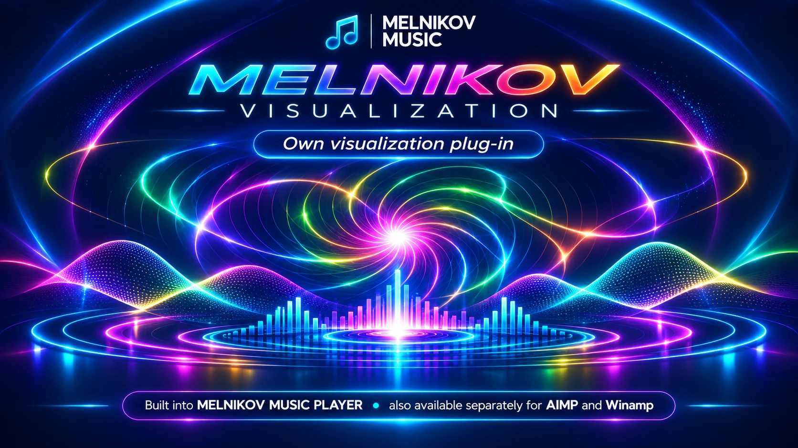
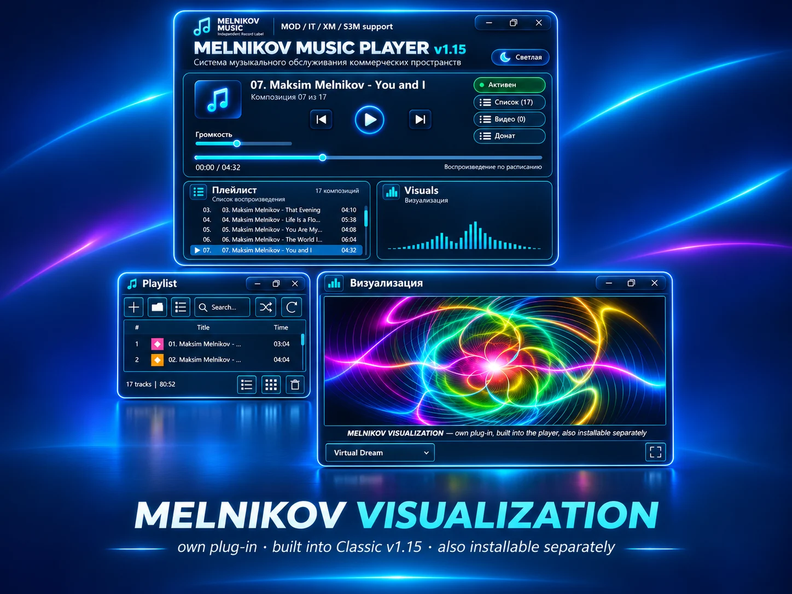
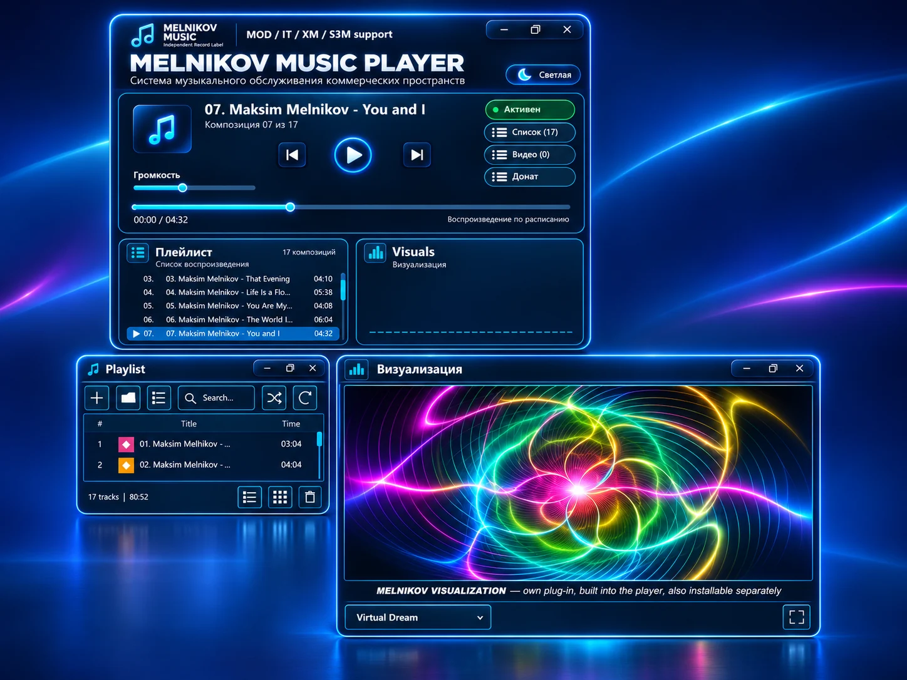

# MELNIKOV VISUALIZATION
## PLUGIN v1.6

**ORIGINAL MUSIC VISUALIZATION · 490 VISUAL VARIATIONS**

### WINDOWS · FREE DOWNLOAD

**[⬇ Скачать установщик · Download Windows Setup — 34.3 MB](https://drive.google.com/file/d/1wc-UMNsBfnj332r2G7PWn1o05FxUzrow/view)**

*For Classic v1.14 and Winamp compatibility testing. Already integrated into Classic v1.15.*

**[Русская страница](https://melnikovmusic.online/virtual-dream/) · [English page](https://melnikovmusic.online/virtual-dream/en/)**

---

## MUSIC YOU CAN SEE · МУЗЫКА, КОТОРУЮ МОЖНО УВИДЕТЬ

MELNIKOV VISUALIZATION v1.6 is **our own music visualization project**, developed for the MELNIKOV MUSIC ecosystem. It combines moving luminous lines, colorful waves, spirals and reactive patterns into **490 visual variants**.

**MELNIKOV VISUALIZATION v1.6 — собственная разработка MELNIKOV MUSIC.** Это отдельный модуль музыкальной визуализации с **490 вариантами**: световые линии, спирали, волны и динамические цветовые композиции.

<table>
<tr>
<td align="center" width="50%"> <b>Original visualization / Собственная визуализация</b></td>
<td align="center" width="50%"> <b>Built into Classic v1.15 / Уже встроена</b></td>
</tr>
</table>

### Where to use it · Где используется

| Application / Программа | Status / Статус |
|:--|:--|
| **MELNIKOV MUSIC PLAYER Classic v1.15** | **Built in / Уже встроена.** Separate installation is not required. |
| **MELNIKOV MUSIC PLAYER Classic v1.14** | Standalone installer / Отдельная установка плагина. |
| **Winamp 5.0 (x86)** | Standalone installer provided for compatibility testing / Отдельная тестовая сборка. |
| **AIMP 5.40.2727 (64-bit)** | Test environment documented; compatibility of this exact EXE is **not yet verified** / Совместимость данного EXE пока не подтверждена. |

### Download and installation · Скачать и установить

### [⬇ MELNIKOV VISUALIZATION v1.6 — DOWNLOAD SETUP.EXE](https://drive.google.com/file/d/1wc-UMNsBfnj332r2G7PWn1o05FxUzrow/view)

**34.3 MB · Windows · Standalone plugin installer**

**Installer / Файл:** `PLUGIN_MVD_v1.6_DP5_FIX4_WINAMP_CLASSIC14_RC_Setup.exe`

1. Download the Windows installer / Скачайте установщик для Windows.
2. Close the target media player before installation / Закройте проигрыватель перед установкой.
3. Run the installer and follow its on-screen instructions / Запустите установщик и следуйте инструкциям.
4. Restart the player and check its visualization controls / Перезапустите плеер и проверьте настройки визуализации.

**Please note:** This particular build names **Winamp and Classic v1.14** as its targets. Do not assume AIMP compatibility from the existence of an AIMP screenshot. The file name includes `RC`, indicating a release-candidate build rather than a final compatibility-certified installer.

**Важно:** конкретная сборка предназначена для Winamp и Classic v1.14. Наименование файла содержит `RC`; совместимость с AIMP требует отдельной проверки.

### Software versions · Версии ПО

The following versions are visible in the screenshots of the test setup / Версии с предоставленных скриншотов:

- **AIMP 5.40.2727 · 64-bit · 08.09.2026**, Windows 11 (build 10.0.26300).
- **Winamp 5.0 · x86 (32-bit) · 14.12.2003**.

These are **documented test environments**, not a claim of successful verification on both platforms / Это сведения о тестовом окружении, а не подтверждение успешной работы в обоих проигрывателях.

### Installer integrity · Проверка установщика

- **File size:** 34,314,829 bytes.
- **SHA-256:** `76b53d17d1b64402d1a49b03a9badc2e53687be8eae233f6c42b398eb3182118`

### Distribution notice · О размещении

The download button currently opens the **Google Drive installer**. A GitHub Release asset has **not** yet been uploaded. For public access, the file owner must enable **Anyone with the link → Viewer** in Google Drive.

Кнопка сейчас открывает установщик на **Google Drive**. Сам EXE пока **не прикреплён к GitHub Releases**. Для скачивания всеми посетителями необходимо включить доступ «Все, у кого есть ссылка → Читатель».

---

**MELNIKOV MUSIC · Independent Record Label**

**Developer / Разработчик: Maksim Melnikov**

[Classic Edition EN](https://melnikovmusic.online/freeplayer/) · [Classic Edition RU](https://melnikovmusic.online/ru_freeplayer/) · [Official Visualization Page](https://melnikovmusic.online/virtual-dream/)

© 2026 MELNIKOV MUSIC. All rights reserved.

