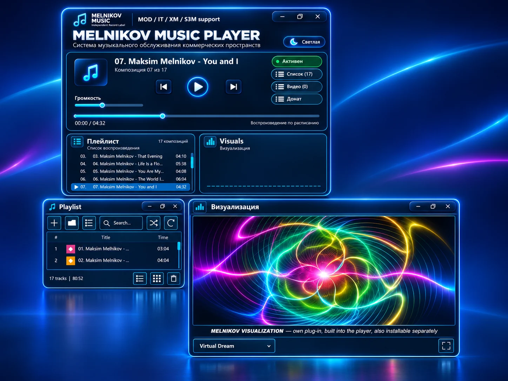
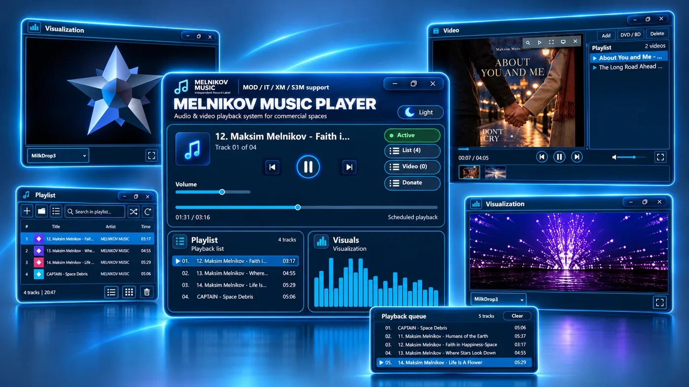
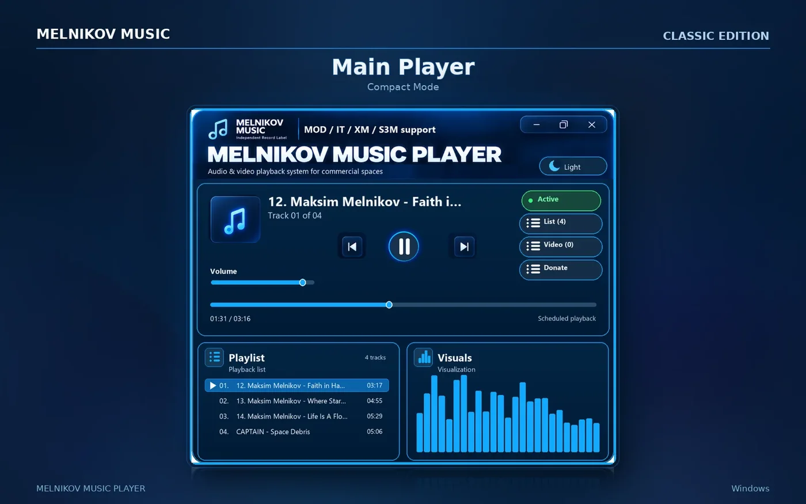
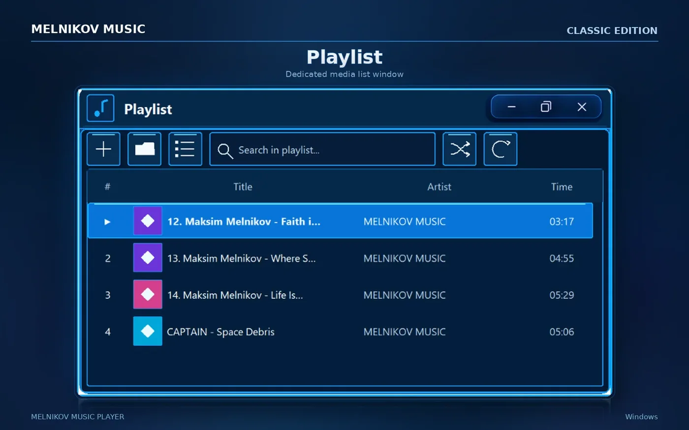
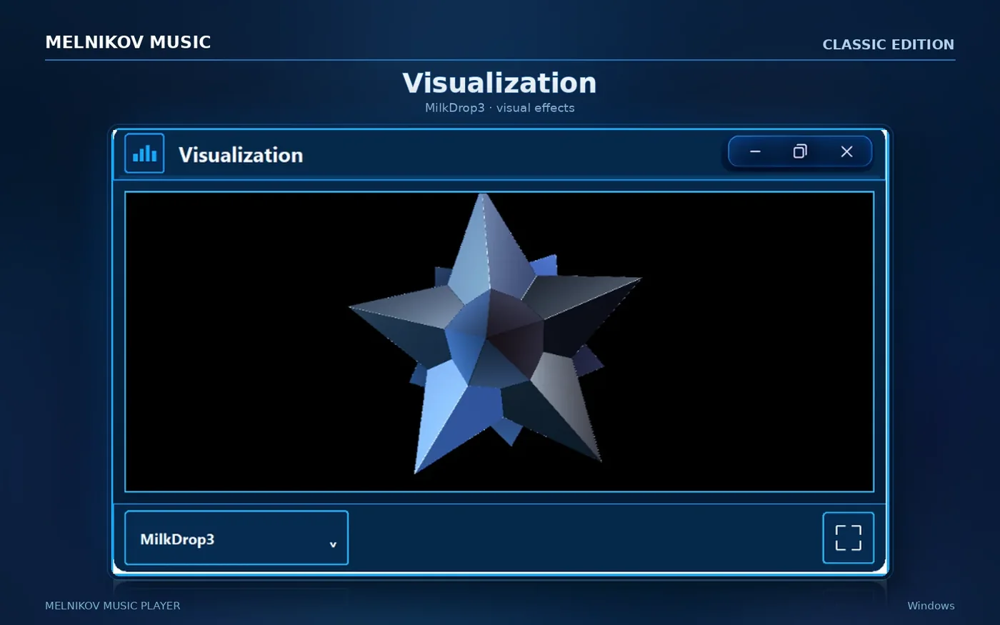
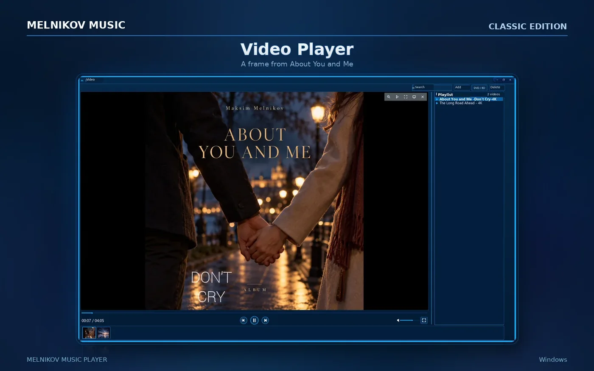

### ✨ MELNIKOV MUSIC PLAYER CLASSIC v1.15

**Our own MELNIKOV VISUALIZATION v1.6 is now built into Classic v1.15.**

**490 visual variations · Two music albums included · English & Русский**

**[Explore v1.15 — visuals, features & release notes](RELEASE_NOTES_v1.15.md)**

v1.15 GitHub installer downloads will be added separately. Previous v1.14 downloads remain available below.

---

# MELNIKOV MUSIC PLAYER
### CLASSIC EDITION

**YOUR MUSIC. YOUR LIBRARY. YOUR SPACE.**

A distinctive audio & video player for Windows — built around your own media, flexible windows and visual experiences.

 

  

---

## Made for your personal media collection

MELNIKOV MUSIC PLAYER **Classic Edition** combines the feel of a classic desktop media player with a modern, blue-neon interface.

Play your music, manage playlists, watch videos and enjoy visualizations — all within a **modular Windows desktop experience**.

**What makes it different**

- **Music & video together** — a single desktop environment for local audio and video playback.
- **Independent windows** — work with **Playlist**, **Visualization** and **Video** as separate modules.
- **Compact and expanded layouts** — arrange the workspace to suit the way you listen.
- **Visual character** — a recognizable neon-blue interface and dynamic visualizations.
- **Your own files** — enjoy local collections without a streaming subscription.

## Explore the player

<table>
  <tr>
    <td width="50%" align="center">
       
      <strong>Main Player</strong>
    </td>
    <td width="50%" align="center">
       
      <strong>Playlist</strong>
    </td>
  </tr>
  <tr>
    <td width="50%" align="center">
       
      <strong>Visualization</strong>
    </td>
    <td width="50%" align="center">
       
      <strong>Video Player</strong>
    </td>
  </tr>
</table>

## Download · Free for Windows

| Edition | Download | Official page |
|:--|:--|:--|
| **English · v1.14.4** | **[Download ZIP from GitHub](https://github.com/xrena45/MELNIKOV_MUSIC_PLAYER_Classic_EN_v1.14.4_Setup/releases/download/v1.14.4/MELNIKOV_MUSIC_PLAYER_Classic_EN_v1.14.4_Setup.zip)** | [English website](https://melnikovmusic.online/freeplayer) |
| **Русская · v1.14.2** | [GitHub mirror — ZIP](https://github.com/xrena45/MELNIKOV_MUSIC_PLAYER_Classic_EN_v1.14.4_Setup/releases/download/ru-v1.14.2/MELNIKOV_MUSIC_PLAYER_Classic_RU_v1.14.2_Setup.zip) | **[Русский сайт / Основная загрузка](https://melnikovmusic.online/ru_freeplayer)** |

**Installation:** Download the ZIP for your language, extract it, and run the included Windows installer.

The RU GitHub download is provided as a **secondary mirror**. The main Russian download remains on the official Russian page.

> **Note:** This repository distributes compiled installers, not the application's source code. Classic Edition is offered free of charge.

## Support independent development

MELNIKOV MUSIC PLAYER is an independent project. If you enjoy using it, you can support its development — entirely optional.

**[Support via Stripe](https://buy.stripe.com/dR617L7MK2t3bi8bIU)** · **[Поддержать через ЮMoney](https://yoomoney.ru/fundraise/1L8UG8TQ38T.261031)**

---

**MELNIKOV MUSIC · Independent Record Label**

[Official English page](https://melnikovmusic.online/freeplayer) · [Русская версия](https://melnikovmusic.online/ru_freeplayer) · [All releases](https://github.com/xrena45/MELNIKOV_MUSIC_PLAYER_Classic_EN_v1.14.4_Setup/releases)

© MELNIKOV MUSIC. All rights reserved.

