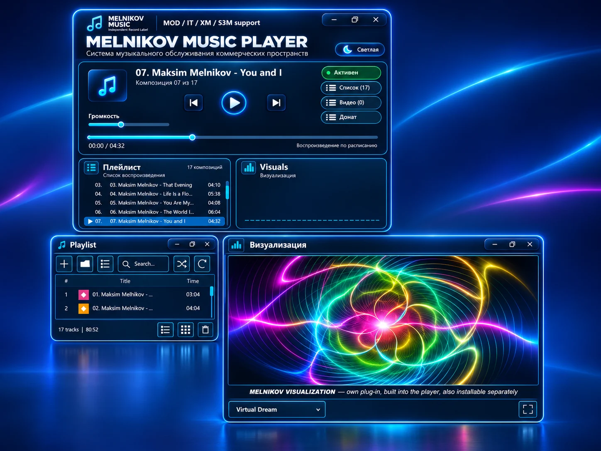
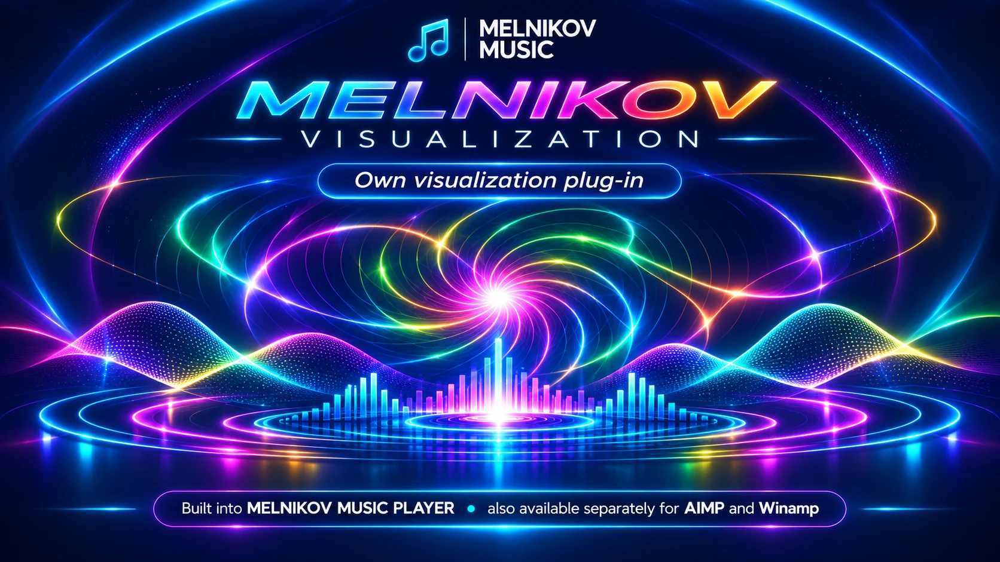
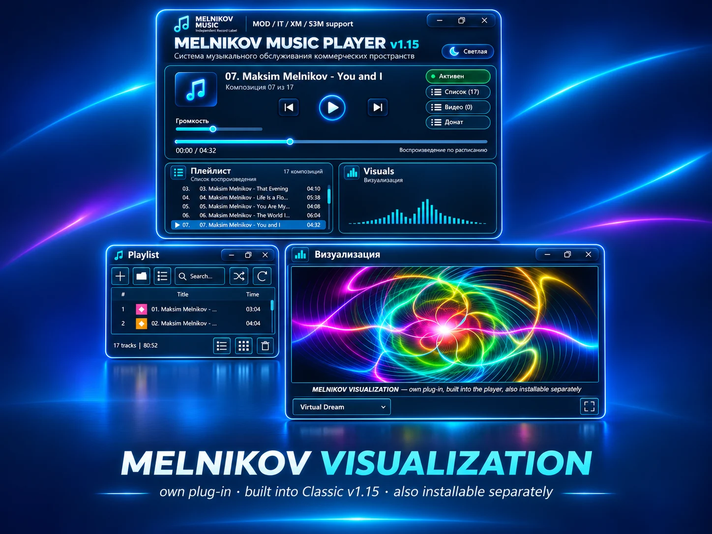

# MELNIKOV MUSIC PLAYER
### CLASSIC EDITION · v1.15

**YOUR MUSIC. YOUR SPACE. YOUR EXPERIENCE.**

**Free audio & video player for Windows · English / Русский**

### MELNIKOV VISUALIZATION v1.6 — BUILT IN

**490 visual variations · Independent windows · Your own media collection**

[Official EN page](https://melnikovmusic.online/freeplayer/) · [Русская версия](https://melnikovmusic.online/ru_freeplayer/) · [Visualization](https://melnikovmusic.online/virtual-dream/)

---

## A new visual experience

MELNIKOV MUSIC PLAYER Classic Edition is independently developed software for Windows: an audio and video player featuring a modular interface, dedicated Playlist, Visualization and Video windows, and your own local music library.

<table><tr>
<td align="center" width="50%"> <strong>MELNIKOV VISUALIZATION v1.6</strong></td>
<td align="center" width="50%"> <strong>490 visual variants</strong></td>
</tr></table>

## What's new in Classic v1.15

- **Our own MELNIKOV VISUALIZATION v1.6 is integrated** — no separate installation is required.
- **490 visualization variants** and a distinct neon-blue interface.
- Independent, resizable Playlist, Video and Visualization windows.
- Playback of your own music and video files with playlist management.
- Separate **English** and **Russian** Windows editions.
- **Two MELNIKOV MUSIC music albums included** — this is why the installers are large (about **337 MB** each).
- **Free Classic Edition:** no subscription required for local media playback.

## Download · Windows

| Edition | Setup filename | Approx. size |
|:--|:--|--:|
| **English** | [⬇ MMP_Classic_EN_v1.15_Setup.exe](https://github.com/xrena45/MELNIKOV_MUSIC_PLAYER_Classic_EN_v1.14.4_Setup/releases/download/v1.15/MMP_Classic_EN_v1.15_Setup.exe) | 337 MB |
| **Русский** | [⬇ MMP_Classic_RU_v1.15_Setup.exe](https://github.com/xrena45/MELNIKOV_MUSIC_PLAYER_Classic_EN_v1.14.4_Setup/releases/download/v1.15/MMP_Classic_RU_v1.15_Setup.exe) | 337 MB |

Both Windows installers are uploaded as separate **GitHub Release assets**. Choose the RU or EN version using the direct download links above. The installers include two MELNIKOV MUSIC albums.

### Visualization: v1.14 versus v1.15

| Classic version | MELNIKOV VISUALIZATION |
|:--|:--|
| **v1.15** | **Already built in**, ready to use |
| **v1.14** | **Download and install separately** |

A standalone visualization plugin for **AIMP / Winamp** is a separate distribution, **not** part of this Classic installer release.

## Русский · О релизе

**MELNIKOV MUSIC PLAYER Classic v1.15** — бесплатный аудио- и видеоплеер для Windows. Доступны отдельные русская и английская сборки.

- Собственная **MELNIKOV VISUALIZATION v1.6 уже встроена в Classic v1.15**.
- **490 вариантов визуализации**, независимые окна плеера, плейлиста и видео.
- В комплект входят **два музыкальных альбома MELNIKOV MUSIC** — поэтому установщик занимает около 337 МБ.
- В Classic **v1.14** визуализацию нужно **скачивать и устанавливать отдельно**.
- Установщики русской и английской версий будут опубликованы в разделе GitHub Releases отдельно.

## Official pages

[English](https://melnikovmusic.online/freeplayer/) · [Русский](https://melnikovmusic.online/ru_freeplayer/) · [Visualization RU](https://melnikovmusic.online/virtual-dream/) · [Visualization EN](https://melnikovmusic.online/virtual-dream/en/) · [Archive](https://melnikovmusic.online/versions/)

Support independent development (optional): [Stripe](https://buy.stripe.com/dR617L7MK2t3bi8bIU) · [ЮMoney](https://yoomoney.ru/fundraise/1L8UG8TQ38T.261031)

---

**MELNIKOV MUSIC · Independent Record Label**

Developed by **Maksim Melnikov** · © 2026 MELNIKOV MUSIC. All rights reserved.
